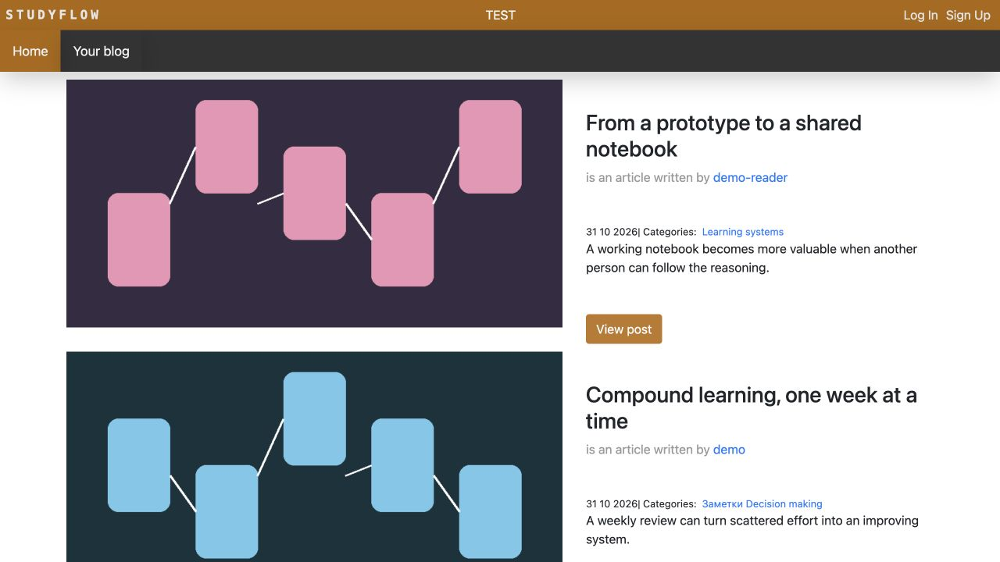
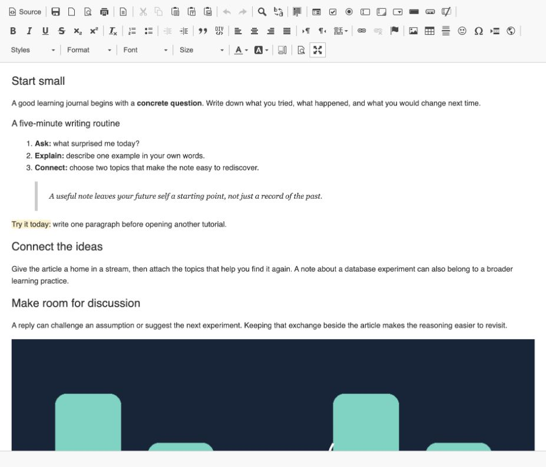
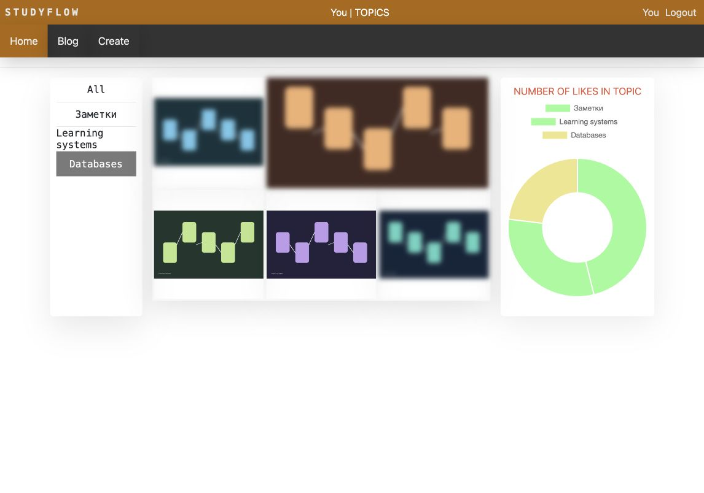
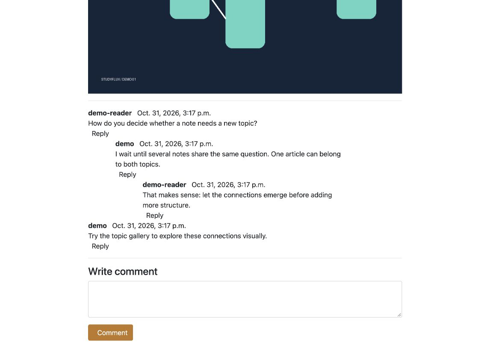
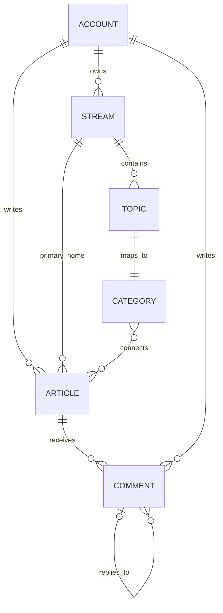

# StudyFlux

**A place to turn scattered study notes into connected knowledge.**

StudyFlux combines a personal publishing space with themed collections and discussion. Write an explanation once, connect it to several topics, pin the pieces worth returning to, and let readers extend the idea in a threaded conversation. A database experiment can belong to both *Databases* and *Learning systems* without becoming two separate articles.

It is a working, database-backed application with accounts, publishing, media, reactions, and a visual way to explore the relationships between articles—not just a collection of static pages.

## Project story

Dmitry Bulakh built the original StudyFlux independently during his student years, without AI assistance. The original work includes the data model, backend, React interface, Django pages, and the interactions connecting them.

The current restoration and maintenance work is a separate chapter, with AI assistance: reproducible local setup, fictional demo content, targeted bug fixes, and updated documentation. It preserves the original product and its architecture rather than presenting the historical code as a new implementation.

## What you can do

- **Publish under your own account.** Registration uses an email confirmation code; readers have personal pages and a blog.
- **Organize knowledge at several levels.** Personal streams such as Development and Economics contain topics. Each topic has a corresponding category; an article can belong to several categories while keeping one primary stream.
- **Build a personal reading surface.** Pin articles to your profile, browse a paginated blog, or discover posts in the shared feed.
- **Write rich articles.** Use the editor for formatted text and embedded images, and add a separate cover image and introduction.
- **Explore connections visually.** The topic gallery highlights the selected topic and blurs unrelated articles while keeping them visible. A chart shows the distribution of likes across topics.
- **Discuss and react.** Readers can like and unlike posts and leave comments with multiple levels of replies.

The application mixes English and Russian interface text. Some screens still use the historical **StudyFlow** wordmark.

## A short tour

All screenshots below use the fictional local demo. The abstract article illustrations are generated specifically for it; no private accounts, personal articles, or uploaded photographs are included.

### Discover articles

The shared feed brings together writing from different authors, with topic links and cover images.



### Write with a visual editor

The demo articles use headings, bold and italic text, ordered and unordered lists, quotations, highlighted notes, links, tables, code samples, and embedded images. Open **Blog → Edit article** as `demo` to try the rich-text toolbar. The editor below is shown in its built-in fullscreen mode.



The same content becomes a formatted reading page:


### Follow a topic without losing context

Selecting **Databases** keeps matching articles clear and the others visible in the background.



### Keep the discussion beside the article

Replies retain their place in the conversation, including replies to replies.



### How the pieces fit



`Stream` is named `Knowledge` in the Django models. Comment ancestry is stored as a PostgreSQL array of IDs, rather than a parent foreign key. The diagram shows the logical relationships.

## Quick start on macOS

Download and extract the [repository ZIP](https://github.com/deepeerie/studyflux/archive/refs/heads/main.zip), open Terminal in the extracted folder, and run:

```sh
bash start.sh
```

Or, if Git is already installed:

```sh
git clone https://github.com/deepeerie/studyflux.git
cd studyflux
bash start.sh
```

Open **http://127.0.0.1:8000/** after the terminal prints the address. Keep that terminal open while using the app.

The first run downloads a pinned **uv 0.13.6**, **Python 3.9.25**, and Python dependencies, including **pgserver 0.1.4** with its PostgreSQL binaries. It initializes the database, applies migrations, and adds the demo. You do not need to install Python, PostgreSQL, Docker, or Node yourself. An internet connection is needed for the initial downloads and for external assets used by some legacy pages.

### Try the demo

The terminal prints the username **`demo`** and a randomly generated password. The demo has two ordinary accounts, Development and Economics streams, several topics (including **Заметки**), six articles, pinned posts, likes, and a discussion with nested replies. Neither account has administrative privileges.

The password is stored in `demo-credentials.json` inside the local data directory, with permissions restricted to your user. Repeated starts keep the same database and do not reset articles, comments, or passwords. If you change the password yourself, the original saved demo password is no longer valid.

To try registration, choose **Sign Up**. In this local configuration, the confirmation email is printed in the terminal running StudyFlux: copy the code from that message. No actual email is sent.

Press **Ctrl+C** in the terminal to stop Django and PostgreSQL cleanly. Start again with the same command.

### Where your data lives

The normal launcher keeps Python, dependencies, PostgreSQL data, generated credentials, and uploaded images outside the repository:

```text
~/Library/Application Support/StudyFlux/local/<checkout-id>/
```

The ID is derived from the project's absolute path. Different clones get separate databases. Moving or renaming the project changes that ID and therefore starts a separate local database; it does not delete the old one.

Both services listen only on localhost. The default ports are `8000` for the website and `55432` for PostgreSQL. If another process uses them, the launcher exits with a clear error. To use another pair:

```sh
STUDYFLUX_WEB_PORT=8001 STUDYFLUX_DB_PORT=55433 bash start.sh
```

**Verified locally on an Apple Silicon Mac.** Intel macOS compatibility is expected from the dependency packages but has not been tested on Intel hardware. The launcher currently rejects other operating systems.

### Moving a private library between Macs

`bash start.sh` is the independent local demo mode. It never imports a cloud dump automatically.

For an existing private, cloud-synchronized copy, use **`bash start-cloud.sh`**. It restores and saves `sync/database.dump`, uses the existing cloud runtime, and retains conflict detection. See [Cloud transfer between Macs](docs/cloud-transfer.md) before switching modes or machines.

## For developers

The backend is **Django + Django REST Framework + PostgreSQL**. The feed and authentication screens use **React 17 and Redux**; profiles, article editing, topic galleries, and discussions also use Django templates and JavaScript. PostgreSQL is required for the comment ancestry arrays.

The compiled React bundle is tracked in `general_page/static/dist/`, so a normal launch does not run npm. To change the frontend, install Node.js/npm separately, then:

```sh
cd general_page
npm ci
npm run build
cd ..
```

`npm run dev` produces a development build. Both commands write to the directory Django serves; commit the rebuilt bundle and its license file alongside source changes. `package-lock.json` records the npm dependency resolution.

With the app stopped, run Django commands through the managed environment:

```sh
bash start.sh --manage test
bash start.sh --manage makemigrations --check --dry-run
```

The launcher starts the local database, applies migrations, leaves existing demo content intact, runs the command, and stops PostgreSQL. Tests use a separate test database. `requirements-local.lock.txt` pins the Python environment used by both macOS launchers; the older deployment dependency files are historical, not the local setup instructions.

See [verification notes](docs/verification.md) for the tested scenarios and their limits.

## Deployment and project status

StudyFlux has a server application architecture: persistent PostgreSQL storage, authenticated publishing, a WSGI entry point, and historical SMTP and S3 integration. It can form the basis of a hosted service for real readers and writers. The macOS launcher is a local development configuration, **not a production deployment recipe**.

Before exposing it publicly:

- Upgrade the legacy Python, Django, frontend dependencies, and CKEditor stack to supported versions, then rerun the product and permission tests.
- Create separate production settings: environment-managed secrets, `DEBUG=False`, explicit hosts/origins, HTTPS, and secure cookies. Do not reuse the repository's historical secret or local settings.
- Review authentication, authorization, registration abuse controls, rich HTML rendering, and upload validation/CSRF protection. The targeted fixes in this restoration are not a completed security audit.
- Run behind a production WSGI server and reverse proxy; configure static files, private database access, persistent media or object storage, SMTP, backups, and restore monitoring.

A hosting provider's assigned HTTPS hostname can be used; a purchased domain is optional. GitHub hosts the source and this documentation, but GitHub Pages cannot run the Django/PostgreSQL application. The old Heroku URL is not maintained as a live demo.
